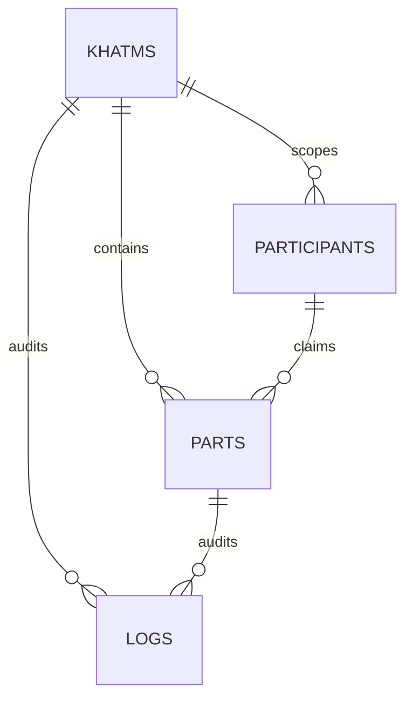

# معماری دیتابیس هم‌نور ۲.۶.۰

## نمای کلی

هم‌نور پنج جدول اختصاصی دارد. نام واقعی هر جدول با `$wpdb->prefix` ساخته می‌شود:

| جدول منطقی | مسئولیت | مالک داده |
|---|---|---|
| `hamnoor_khatms` | موجودیت ختم، مالک، نوع، انتشار، ظاهر و سیاست قرائت/آزادسازی | هسته |
| `hamnoor_parts` | سهم‌های هر ختم و lifecycle رزرو تا انجام/آزادسازی | هسته |
| `hamnoor_participants` | هویت تماس participant در محدوده یک ختم و tracking token | هسته |
| `hamnoor_logs` | audit پایه عملیات | هسته |
| `hamnoor_otps` | درخواست‌های OTP اختیاری و مصرف آن‌ها | هسته |

پیشوند نمونه `wp_` در این سند حذف شده است. در نصب واقعی نام‌ها مانند `wp_hamnoor_khatms` خواهند بود.

## جدول ختم‌ها

### ستون‌های مهم

- شناسه و URL: `id`, `token`, `slug`
- محتوا: `title`, `intention`, `description`, `cover_id`, `cover_url`
- مالک: `owner_user_id`, `owner_name`, `owner_phone`, `owner_email`
- ساختار ختم: `khatm_type`, `khatm_count`, `parts_per_khatm`, `total_parts`, `max_khatm_count`
- رفتار: `completion_mode`, `auto_release_mode`, `auto_release_after_days`, `auto_release_at`
- ظاهر: `design_style`, رنگ‌های سفارشی، `cover_layout`, اطلاعات featured
- انتشار: `privacy`, `status`, `indexable`
- زمان: `starts_at`, `ends_at`, `completed_at`, `created_at`, `updated_at`

### indexها

| index | ستون‌ها | کاربرد |
|---|---|---|
| `PRIMARY` | `id` | lookup اصلی |
| `UNIQUE token` | `token` | route و جلوگیری از token تکراری |
| `slug` | `slug` | سازگاری URL خوانا |
| `privacy`, `status` | تک‌ستونی | فیلترهای عمومی/مدیریتی |
| `owner_user_id` | `owner_user_id` | داشبورد مالک |
| `created_at` | `created_at` | sort/pagination زمانی |
| `owner_status` | `owner_user_id, status` | ختم‌های مالک بر اساس وضعیت |
| `public_index` | `privacy, status, indexable` | sitemap و فهرست ختم‌های قابل انتشار |
| featured/contact | ستون‌های متناظر | فیلتر ویژه و جستجوی مدیریتی |

## جدول سهم‌ها

### ستون‌های مهم

- رابطه: `khatm_id`, `participant_id`
- ساختار: `round_number`, `part_type`, `part_number`, `title`, `quran_ref`, `quran_url`
- lifecycle: `status`, `claimed_at`, `done_at`, `released_at`, `released_by`, `release_reason`
- زمان: `created_at`, `updated_at`

وضعیت‌های عملی فعلی `available`, `claimed`, `done` هستند. آزادسازی یک سهم، status را به `available` برمی‌گرداند و اطلاعات audit آزادسازی را حفظ می‌کند.

### indexها

| index | ستون‌ها | کاربرد |
|---|---|---|
| `PRIMARY` | `id` | lookup سهم |
| `khatm_id` | `khatm_id` | همه queryهای صفحه/مدیریت ختم |
| `participant_id` | `participant_id` | سهم‌های participant و حذف orphan |
| `round_number`, `status` | تک‌ستونی | فیلترهای موجود |
| `khatm_status_round` | `khatm_id, status, round_number` | انتخاب next/random، pagination و count |
| `status_claimed_at` | `status, claimed_at` | آزادسازی خودکار موعددار |
| `released_at` | `released_at` | audit/report پایه |
| `part_type_number` | `part_type, part_number` | جستجوی نوع/شماره سهم |

## جدول شرکت‌کنندگان

### ستون‌های مهم

- `khatm_id` محدوده هویت participant را تعیین می‌کند.
- `user_id` اتصال اختیاری به کاربر وردپرس است.
- `name`, `phone`, `email`, `normalized_phone` اطلاعات تماس پایه‌اند.
- `tracking_token` دسترسی scoped سهم و پیگیری را پشتیبانی می‌کند.
- `created_at`, `updated_at` زمان‌های استانداردند.

### indexها

| index | ستون‌ها | کاربرد |
|---|---|---|
| `khatm_id` | `khatm_id` | شرکت‌کنندگان یک ختم |
| `user_id` | `user_id` | داشبورد کاربر |
| `email`, `normalized_phone` | تک‌ستونی | پیگیری سراسری تماس |
| `tracking_token` | `tracking_token` | دسترسی scoped |
| `khatm_phone` | `khatm_id, normalized_phone` | find-or-create participant با موبایل |
| `khatm_email` | `khatm_id, email` | find-or-create participant با ایمیل |
| `user_khatm` | `user_id, khatm_id` | اتصال کاربر به مشارکت‌های یک ختم |

در نسخه فعلی uniqueness دیتابیسی روی تماس وجود ندارد، زیرا منطق محصول participant را با «موبایل یا ایمیل» merge می‌کند و برخی ورودی‌ها email ندارند. جلوگیری اتمیک کامل از duplicate participant در concurrency بسیار بالا، در صورت نیاز عملیاتی، بهتر است با یک `identity_hash` migrationشده در نسخه آینده انجام شود؛ افزودن unique index روی nullable phone/email به‌تنهایی semantics فعلی را دقیق مدل نمی‌کند.

## جدول لاگ‌ها

ستون‌ها: شناسه‌های `khatm_id`, `part_id`, `participant_id`, `user_id`، سپس `action`, `message`, IP، user agent و `created_at`.

indexهای رابطه‌ای و `action` موجودند. index جدید `created_at` پاک‌سازی ۹۰روزه را از full scan دور می‌کند. لاگ پایه برای audit کاربردی است، نه سامانه analytics دائمی؛ گزارش تحلیلی پیشرفته باید جدول ادان خود را داشته باشد.

## جدول OTP

ستون‌ها: تماس خام/نرمال، hash کد، `purpose`, `expires_at`, `consumed_at`, IP و timestamps.

کد OTP خام در جدول ذخیره نمی‌شود. indexهای `normalized_contact`, `purpose`, `expires_at` و composite `expires_consumed` lookup و cleanup را پوشش می‌دهند. provider ارسال پیامک جزو این جدول یا هسته نیست.

## رابطه‌ها

- `parts.khatm_id → khatms.id`
- `participants.khatm_id → khatms.id`
- `parts.participant_id → participants.id` به‌صورت nullable
- شناسه‌های لاگ nullable هستند تا خطاهای قبل از تکمیل entity نیز ثبت شوند.
- `owner_user_id`, `participant.user_id`, `released_by`, `logs.user_id` به `wp_users.ID` اشاره منطقی دارند.

foreign key فیزیکی عمداً تعریف نشده است. نصب/حذف وردپرس، prefixهای متفاوت و رفتار `dbDelta()` با رابطه‌های نرم سازگارتر است. integrity در transaction و repository/DB layer کنترل می‌شود.

## transaction و هم‌زمانی

- ایجاد ختم و batch تولید سهم در transaction انجام می‌شود.
- claim سهم با update شرطی `status=available` اتمیک می‌شود.
- در race ناموفق، participant تازه و بدون سهم به‌صورت امن پاک می‌شود.
- complete/release روی وضعیت جاری کنترل دارند؛ release update نیز شرط `status=claimed` دارد.
- تکمیل کل ختم با update شرطی `status <> completed` idempotent شد.

## نصب و migration

1. `Hamnoor_DB::install()` جدول‌ها، optionها، roleها و برگه‌ها را ایجاد می‌کند.
2. `HAMNOOR_DB_VERSION` در ۲.۶.۰ برابر `2.6.0` است.
3. `maybe_upgrade()` هنگام اختلاف نسخه، `create_tables()`/`dbDelta()` و سازنده‌های idempotent را اجرا می‌کند.
4. migration ۲.۶.۰ فقط indexها را اضافه می‌کند؛ جدول/ستون یا داده‌ای drop نمی‌شود.
5. توکن ۱۲ کاراکتری فقط برای ختم جدید است؛ tokenهای قبلی برای backward compatibility تغییر نمی‌کنند.
6. پاک‌سازی داده فقط در uninstall و فقط با `delete_data_on_uninstall=1` انجام می‌شود.

## آزادسازی خودکار

query جدید دو حالت را در SQL محدود می‌کند:

- `after_days`: زمان claim باید از `now - auto_release_after_days` قدیمی‌تر باشد.
- `fixed_date`: تاریخ تنظیم‌شده باید رسیده باشد.

فقط سهم `claimed` با `completion_mode=manual_done` و بدون `done_at` وارد batch می‌شود. ترتیب `claimed_at, id` و سقف ۵۰۰ مانع query/loop نامحدود است.

## توسعه آینده بدون تغییر اساسی

| ادان | الگوی ذخیره پیشنهادی | اتصال به هسته |
|---|---|---|
| SMS/notification | جدول queue/delivery متعلق به ادان | `khatm_id`, `part_id`, lifecycle hooks، provider interface |
| reminder | جدول schedule/attempt متعلق به ادان | `claimed_at`, after-claim/complete/release hooks |
| payment/nazr | جدول transaction متعلق به ادان | `khatm_id`, `user_id` و hookهای create/status |
| advanced reporting | aggregate/read model متعلق به ادان | export/report filters و lifecycle hooks |
| QR/template packs | معمولاً بدون جدول؛ option یا post meta ادان | invite URL و template/card filters |

افزودن ستون‌های provider-specific به جداول هسته توصیه نمی‌شود. این جداسازی باعث می‌شود حذف ادان داده اصلی ختم/سهم را تحت تأثیر قرار ندهد.

## نتیجه معماری

برای نسخه پایه و مقیاس فعلی، ساختار دیتابیس کافی و قابل توسعه است و تغییر اساسی دیگری قبل از انتشار لازم نیست. دو بهبود احتمالی آینده—`identity_hash` یکتا برای participant در بار هم‌زمان بسیار بالا و sampling جایگزین `ORDER BY RAND()` در datasetهای بسیار بزرگ—به داده و مقیاس واقعی وابسته‌اند و مانع RC نیستند.
